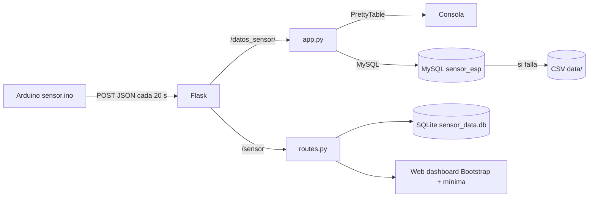

# python-weather-station

Estación meteorológica casera: sensores de temperatura/humedad conectados a un **Arduino/ESP** publican datos por HTTP y dos backends **Flask** los reciben, los muestran en consola y los persisten (MySQL o SQLite, con fallback a CSV).

[](https://python.org)
[](https://flask.palletsprojects.com)
[](https://www.arduino.cc)

## Contenido

- [Características](#características)
- [Componentes](#componentes)
- [Arquitectura](#arquitectura)
- [Stack](#stack)
- [Estructura del repositorio](#estructura-del-repositorio)
- [Instalación](#instalación)
- [Uso](#uso)
- [Configuración](#configuración)
- [Roadmap](#roadmap)
- [Licencia](#licencia)

## Características

- Firmware **Arduino (`sensor.ino`)** con Ethernet + `DallasTemperature` que publica JSON cada 20 s y alterna entre dos servidores por redundancia.
- **Backend `app.py`**: recibe `POST /datos_sensor/` con temperatura/humedad de sensores DHT22 (exterior) y DHT11 (interior), los muestra en consola con `PrettyTable` y los persiste en **MySQL** (con fallback a **CSV**).
- **Backend `routes.py`**: recibe `POST /sensor` con una temperatura, la guarda en **SQLite** y expone un **dashboard web Bootstrap** con la última lectura y la mínima histórica.
- Almacenamiento doble: CSV (`data/`) y bases de datos.

## Componentes

| Archivo        | Rol                                                                 |
|----------------|---------------------------------------------------------------------|
| `sensor.ino`   | Firmware Arduino: lee un sensor de temperatura vía OneWire y hace POST JSON |
| `app.py`       | Flask: endpoint `/datos_sensor/` (DHT11 + DHT22), consola y MySQL/CSV |
| `routes.py`    | Flask + SQLite: endpoint `/sensor`, `/data` y dashboard             |

## Arquitectura



## Stack

- Python 3, Flask 3.0
- MySQL (`mysql.connector`), SQLite
- `PrettyTable`, `colorama`, `termcolor`
- Arduino/C++: Ethernet, OneWire, DallasTemperature, ArduinoJson
- Bootstrap para el dashboard

## Estructura del repositorio

```
python-weather-station/
├── app.py
├── routes.py
├── sensor.ino
├── requirements.txt
├── data/                      # CSVs de sensores y backups
├── sensor_data.db             # SQLite generada por routes.py
├── templates/                 # HTML del dashboard
└── static/                    # CSS/JS del tema (Bootstrap, iconos)
```

## Instalación

```bash
git clone https://github.com/bi0punk/python-weather-station.git
cd python-weather-station
python -m venv .venv && source .venv/bin/activate
pip install -r requirements.txt
```

## Uso

**Firmware:** carga `sensor.ino` en la placa (con Ethernet shield). Ajusta las IPs del Arduino y de los servidores (`server1`/`server2`) al inicio del sketch.

**Backend MySQL (`app.py`):**

```bash
# crea la base 'sensor_esp' e inserta (temperatura, humedad)
python app.py              # escucha en 0.0.0.0:8000
```

> Las credenciales de MySQL están hardcodeadas en `save_to_db()`: edítalas antes de usar.

**Backend SQLite (`routes.py`):**

```bash
python routes.py           # escucha en la IP configurada, puerto 5000
```

Los sensores envían por ejemplo:

```json
{"temperatura_dht22": 22.3, "humedad_dht22": 55.0, "temperatura_dht11": 21.8, "humedad_dht11": 60.1}
```

## Configuración

| Endpoint       | Método | Payload esperado                                        |
|----------------|--------|----------------------------------------------------------|
| `/datos_sensor/` | POST | `{temperatura_dht22, humedad_dht22, temperatura_dht11, humedad_dht11}` |
| `/sensor`        | POST | `{"temperature": <float>}`                                |
| `/data`          | GET  | Última temperatura en JSON                                |
| `/`              | GET  | Dashboard HTML                                            |

## Roadmap

- [x] Publicación desde Arduino con redundancia de servidor
- [x] Persistencia MySQL con fallback CSV
- [x] Dashboard SQLite con mínima histórica
- [ ] Mover credenciales de base a variables de entorno
- [ ] Unificar ambos backends en una sola app
- [ ] Docker Compose con MySQL

## Licencia

Sin archivo `LICENSE` declarado en el repositorio.